# 🌍 TravelTales India – DevSecOps & GitOps Project

A full-stack travel blogging application built with **React, Node.js, MongoDB, and Redis**, deployed on **AWS EKS** using a DevSecOps and GitOps-based CI/CD pipeline.

This project demonstrates automated CI/CD with Jenkins, code quality analysis using SonarQube, security scanning with Trivy and OWASP Dependency-Check, containerization with Docker, GitOps deployments using ArgoCD, and monitoring with Prometheus and Grafana.
# 🚀 Project Architecture

## 🔄 CI/CD Pipeline Architecture

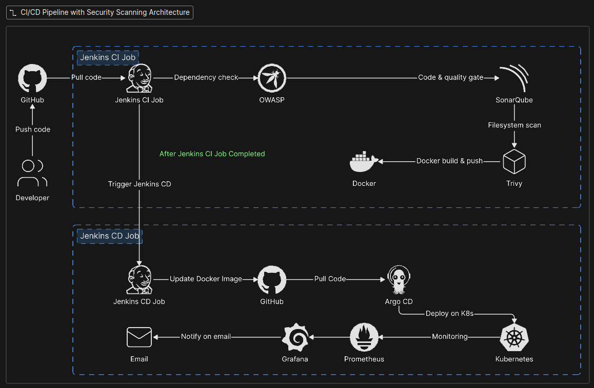

---

## 🛡️ DevOps & DevSecOps — End-to-End CI/CD Architecture

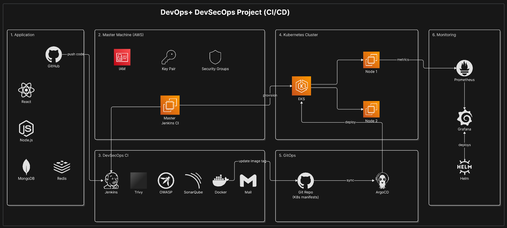

---


## 🏗️ Technology Stack

| Category | Technology |
|---|---|
| Frontend | React.js |
| Backend | Node.js |
| Database | MongoDB |
| Caching | Redis |
| Cloud Platform | AWS |
| CI/CD Server | Jenkins |
| Code Quality | SonarQube |
| Dependency Scanning | OWASP Dependency-Check |
| Security Scanning | Trivy |
| Containerization | Docker |
| Container Orchestration | Kubernetes |
| Kubernetes Platform | AWS EKS |
| GitOps | Argo CD |
| Infrastructure Hosting | AWS EC2 |
| Monitoring | Prometheus |
| Visualization | Grafana |
| Version Control | Git |
| Source Code Management | GitHub |
| CI/CD Pipeline Scripting | Jenkins Pipeline |
| Container Registry | Docker Hub / Configured Registry |
| Operating System | Ubuntu Linux |
| Notifications | Email Alerts |


## ✨ Features

### 🌍 Application Features
- 🧭 **Travel Discovery:** Explore popular travel destinations across India.
- 🔐 **User Authentication:** User registration and login.
- ✍️ **Travel Blogging:** Create and share travel blogs.
- ⭐ **Community Reviews:** Share experiences and reviews of destinations.
- 👥 **User Interaction:** Engage with the travel community.
- 📱 **Responsive UI:** React-based user interface.
- ⚡ **Caching:** Redis integration for improved response times.
- 🗄️ **Database Management:** MongoDB for storing application data.

### 🔄 DevSecOps & CI/CD
- ⚙️ **Automated CI Pipeline:** Jenkins automates the build and validation workflow.
- 🔍 **Code Quality Analysis:** SonarQube identifies code quality issues and bugs.
- 🛡️ **Dependency Scanning:** OWASP Dependency-Check detects vulnerable dependencies.
- 🔒 **Security Scanning:** Trivy scans container images and filesystems for vulnerabilities.
- 🐳 **Docker Containerization:** Packages application components into containers.
- 📦 **Container Image Management:** Push and manage images in a container registry.
- 🚀 **Automated Deployment Workflow:** Jenkins coordinates the deployment pipeline.

### ☸️ Kubernetes & GitOps
- ☁️ **AWS EKS Deployment:** Run containerized applications on Kubernetes.
- 🔁 **GitOps Workflow:** Git repositories maintain the desired Kubernetes configuration.
- 🎯 **Argo CD Synchronization:** Synchronizes Kubernetes resources with Git-defined configuration.
- 📈 **Scalable Architecture:** Kubernetes supports application scaling and workload management.
- 🔄 **Declarative Deployment:** Kubernetes manifests define the desired application state.

### 📊 Monitoring & Observability
- 📡 **Metrics Collection:** Prometheus collects infrastructure and application metrics when configured.
- 📊 **Monitoring Dashboards:** Grafana visualizes collected metrics.
- 🚨 **Failure Notifications:** Email alerts for pipeline or system failures, when configured.
- 🔎 **System Observability:** Monitor cluster health and application performance.

### ☁️ Cloud Infrastructure
- 🖥️ **AWS EC2:** Hosts the Jenkins CI/CD environment.
- 🌐 **AWS EKS:** Provides managed Kubernetes infrastructure.
- 🔗 **Automated Workflow Integration:** Connects source control, CI/CD, containerization, and deployment.
- 🔐 **Security-Focused Pipeline:** Integrates code quality and vulnerability checks into the delivery workflow.

## 📁 Project Structure

```text
traveltales-india/
│
├── Automations/
│   ├── updatebackendnew.sh
│   └── updatefrontendnew.sh
│
├── backend/
│   ├── api/
│   ├── config/
│   ├── controllers/
│   ├── middlewares/
│   ├── models/
│   ├── routes/
│   ├── services/
│   ├── tests/
│   ├── utils/
│   ├── app.ts
│   ├── Dockerfile
│   └── package.json
│
├── frontend/
│   ├── public/
│   ├── src/
│   ├── Dockerfile
│   ├── nginx.conf
│   ├── vite.config.ts
│   └── package.json
│
├── GitOps/
│   └── Jenkinsfile
│
├── kubernetes/
│   ├── backend.yaml
│   ├── frontend.yaml
│   ├── mongodb.yaml
│   └── redis.yaml
│
├── photos/
│
├── Jenkinsfile
├── docker-compose.yml
├── package.json
├── package-lock.json
├── .gitignore
└── README.md
```

## 🚀 Clone & Run Project

### 📋 Prerequisites

- Git
- Docker
- Docker Compose

### 1. Clone the Repository

```bash
git clone https://github.com/smk233/traveltales-india.git
cd traveltales-india
```

### 2. Run Using Docker Compose

Build the images and start the application:

```bash
docker compose up --build -d
```

### 3. Check Running Containers

```bash
docker compose ps
```

View application logs:

```bash
docker compose logs -f
```

### 4. Stop the Application

```bash
docker compose down
```

### 🛠️ Run Frontend and Backend Separately

**Backend:**
```bash
cd backend
npm install
npm run
```

**Frontend:** Open a separate terminal:

```bash
cd frontend
npm install
npm run
```

Check each directory's `package.json` for the available development scripts before starting the services. Configure any required environment variables before running the application.


# 📸 Project Screenshots

## 🌍 TravelTales India — Live Application

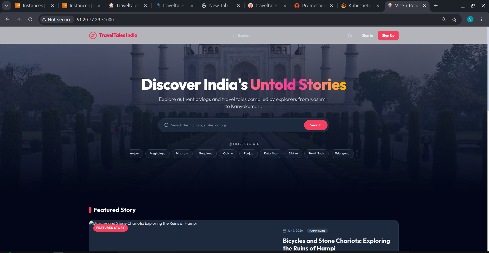

---

## ☁️ AWS EC2 Infrastructure

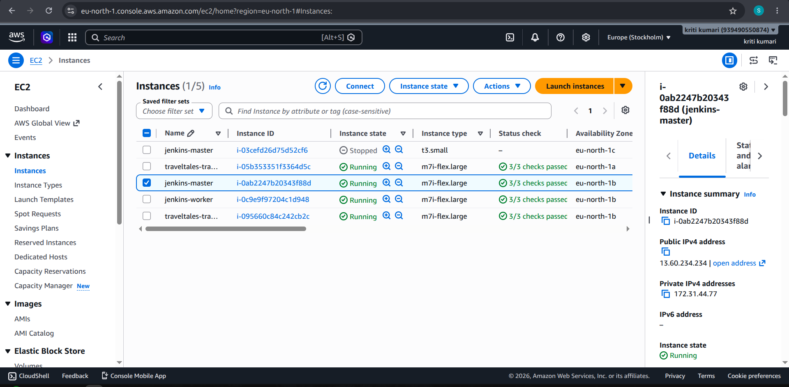

---

## 🔄 Jenkins CI Pipeline — Initial Builds

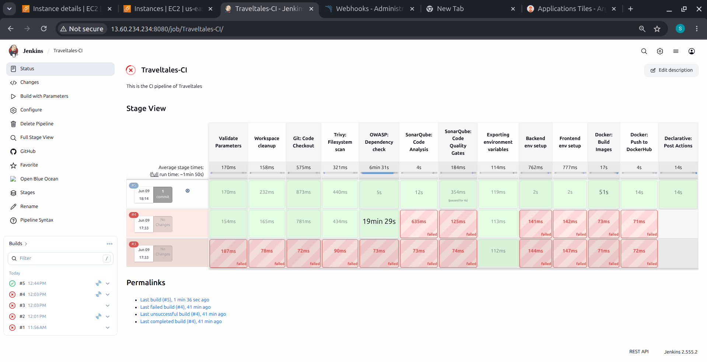

---

## ✅ Jenkins CI Pipeline — Successful Builds

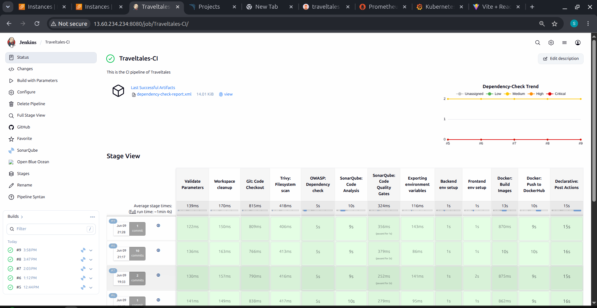

---

## 🔍 SonarQube Code Quality Analysis

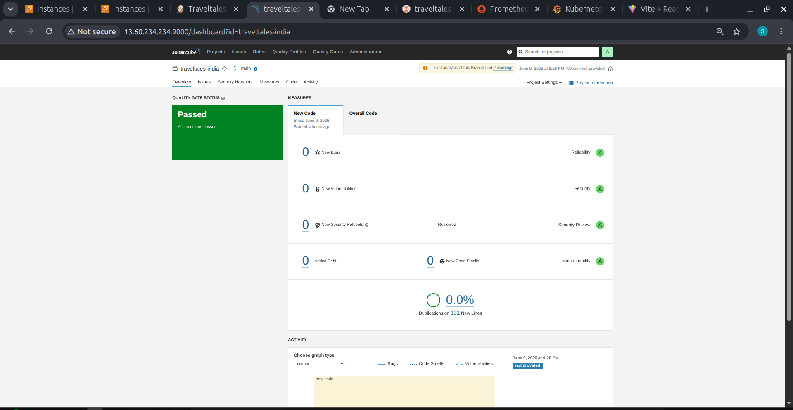

---

## 🐳 Docker Hub Repositories

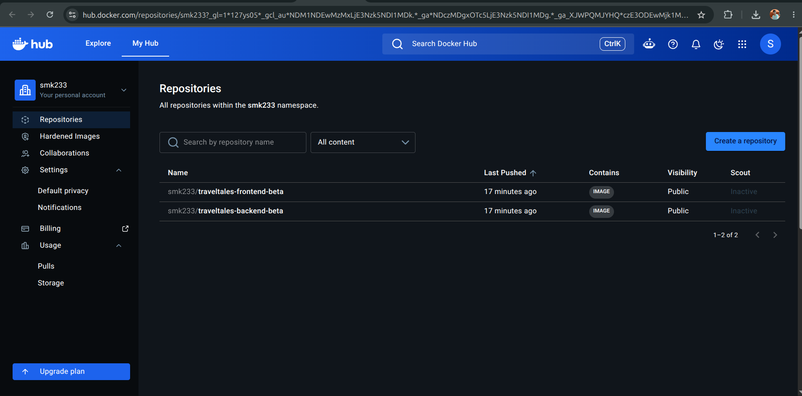

---

## 🚀 Jenkins CD Pipeline

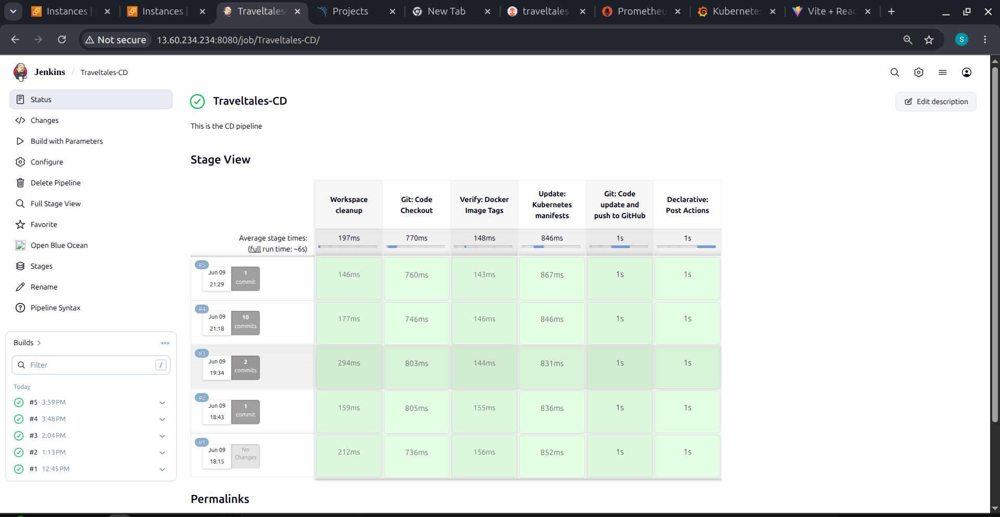

---

## 📧 Deployment Success Email Notification

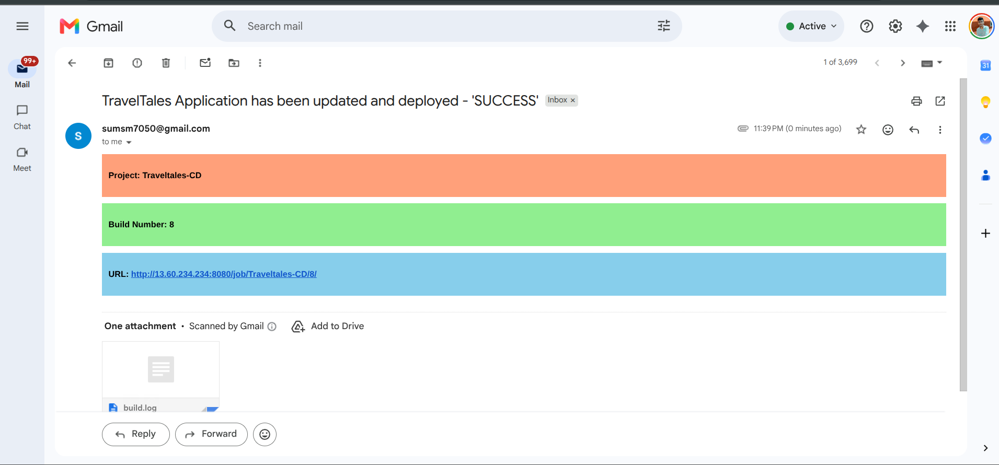

---

## 🔁 Argo CD — GitOps Deployment

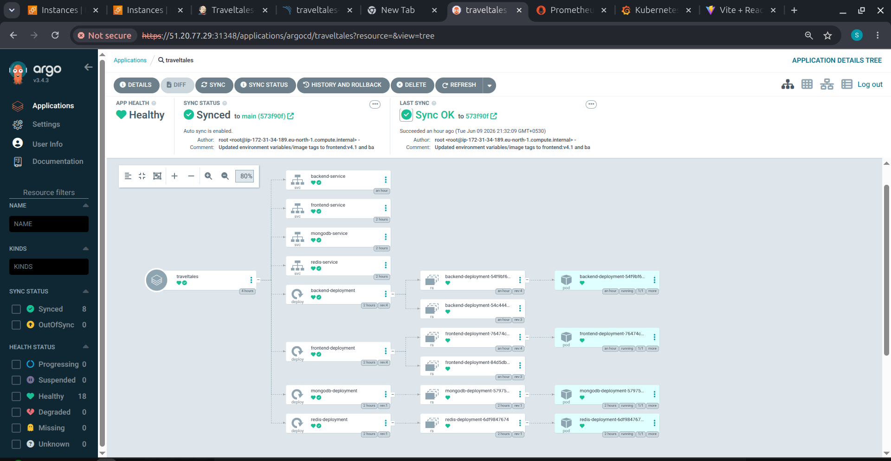

---

## ☸️ AWS EKS — Kubernetes Resources

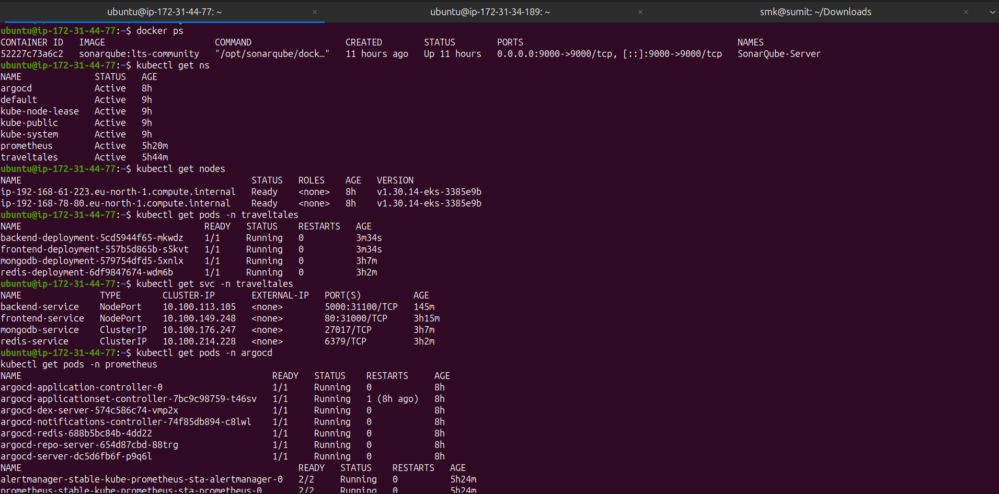

---

## 📈 Prometheus Monitoring Targets

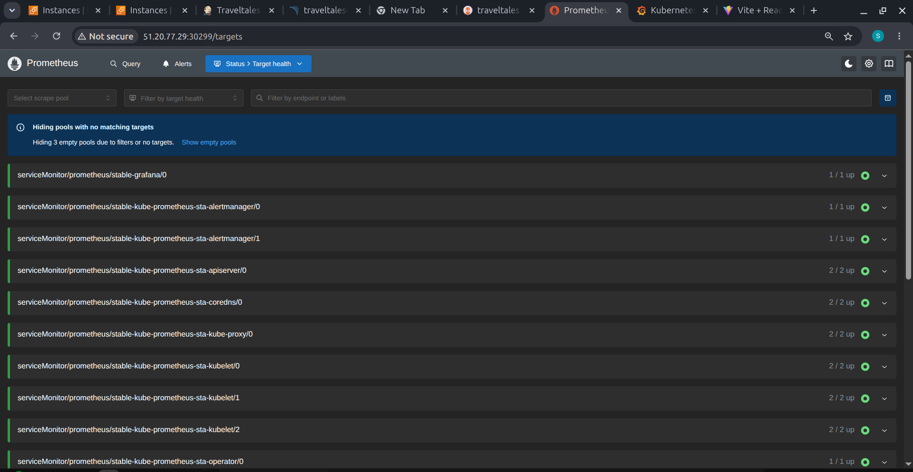

---

## 📊 Grafana Dashboard — CPU & Memory Usage

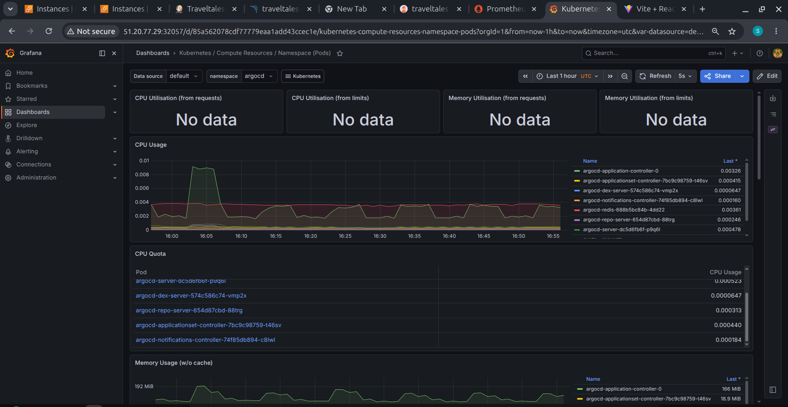

---

## 💾 Grafana Dashboard — Memory Quota & Network Usage

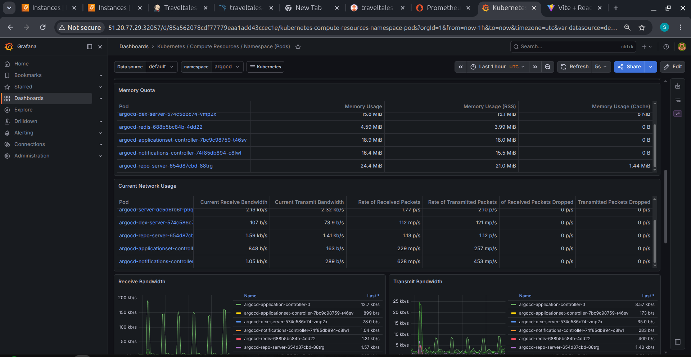

---

## 🌐 Grafana Dashboard — Network Bandwidth & Packets

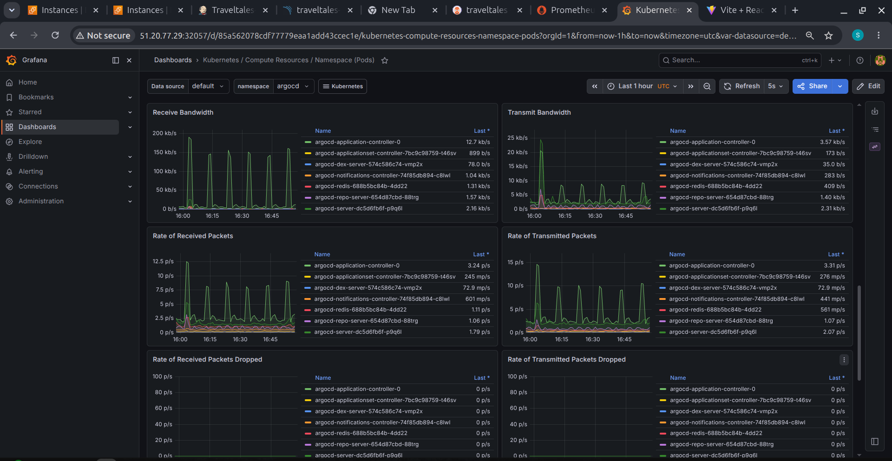


# 🔧 DevOps & DevSecOps Concepts Implemented

- Docker Containerization
- Docker Image Build and Publishing
- Jenkins CI/CD Pipeline Automation
- Automated Code Quality Analysis using SonarQube
- Dependency Vulnerability Scanning using OWASP Dependency-Check
- Container Security Scanning using Trivy
- Docker Image Management
- AWS EC2 Infrastructure Management
- Kubernetes Container Orchestration using AWS EKS
- GitOps-Based Deployment using Argo CD
- Kubernetes Deployments and Services
- Environment Variable Management
- MongoDB and Redis Integration
- Application and Cluster Monitoring using Prometheus
- Metrics Visualization using Grafana
- Git and GitHub Version Control
- Deployment Notifications and Troubleshooting

---

# 📚 What I Learned

- Building and deploying a full-stack application using React and Node.js.
- Containerizing application components using Docker.
- Automating CI/CD workflows using Jenkins.
- Integrating SonarQube for automated code quality analysis.
- Scanning dependencies and container images for security vulnerabilities.
- Deploying and managing containerized applications on AWS EKS.
- Implementing GitOps workflows using Argo CD.
- Managing Kubernetes deployments and services.
- Working with MongoDB and Redis in a distributed application.
- Monitoring application infrastructure using Prometheus and Grafana.
- Troubleshooting CI/CD pipeline failures and deployment issues.
- Understanding DevOps and DevSecOps practices in a practical project.

---

# 📄 License

This project can be distributed under the MIT License if an MIT `LICENSE` file is included in the repository.

See the [LICENSE](LICENSE) file for details.

---

# 👨‍💻 Author

**Sumit Kumar**

- **GitHub:** https://github.com/smk233
- **LinkedIn:** https://www.linkedin.com/in/sumitsmk

---
