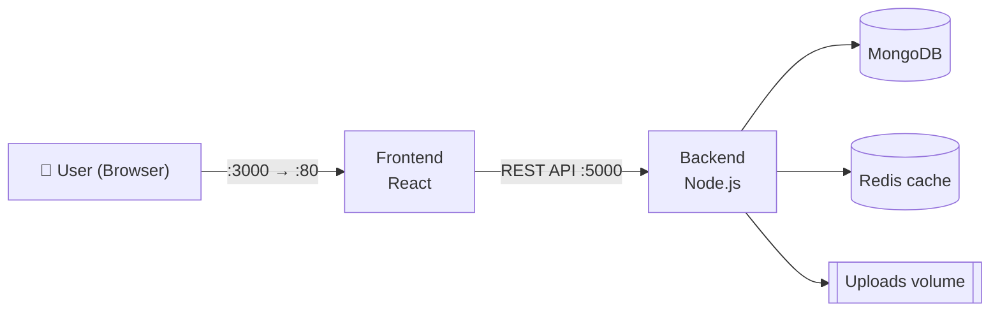
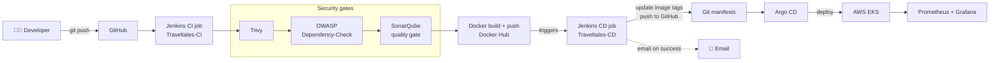

<div align="center">

# 🌏 TravelTales India

**A full-stack travel blogging platform, delivered through a DevSecOps + GitOps pipeline on AWS.**

[](https://react.dev)
[](https://nodejs.org)
[](https://www.mongodb.com)
[](https://redis.io)
<br/>
[](https://www.jenkins.io)
[](https://www.docker.com)
[](https://kubernetes.io)
[](https://aws.amazon.com)
<br/>
[](https://argo-cd.readthedocs.io)
[](https://www.sonarsource.com/products/sonarqube/)
[](https://trivy.dev)
[](https://owasp.org/www-project-dependency-check/)
[](https://prometheus.io)
[](https://grafana.com)

</div>

---

## 📑 Table of Contents

- [Overview](#overview)
- [Project Status](#project-status)
- [Features](#features)
- [Tech Stack](#tech-stack)
- [Application Screenshot](#application-screenshot)
- [Architecture](#architecture)
- [CI Pipeline](#ci-pipeline)
- [DevSecOps Security Scans](#devsecops-security-scans)
- [CD Pipeline](#cd-pipeline)
- [Docker](#docker)
- [AWS Infrastructure](#aws-infrastructure)
- [Kubernetes on EKS](#kubernetes-on-eks)
- [GitOps with Argo CD](#gitops-with-argo-cd)
- [Monitoring and Notifications](#monitoring-and-notifications)
- [Getting Started](#getting-started)
- [Project Workflow](#project-workflow)
- [Key Takeaways](#key-takeaways)
- [Future Enhancements](#future-enhancements)
- [Repository Structure](#repository-structure)
- [Reference](#reference)
- [Author](#author)

---

## Overview

**TravelTales India** lets travelers register, discover curated Indian destinations, write rich travel blogs, post community reviews, and interact with other travelers.

This repository has two goals:

| 🧭 As a product | ⚙️ As a DevOps project |
|---|---|
| A MERN-stack travel blogging and vlogging platform with Redis caching on the backend. | A hands-on DevSecOps + GitOps build: Jenkins CI/CD on AWS EC2, security gates, Docker images, Kubernetes on EKS, Argo CD delivery, and Prometheus/Grafana monitoring. |

---

## Project Status

| Area | Status | Evidence |
|---|:---:|---|
| MERN application (React, Node.js, MongoDB) + Redis cache | ✅ | [Screenshot](#application-screenshot), [pods](#kubernetes-on-eks) |
| Local run with Docker Compose | ✅ | `docker-compose.yml` |
| Jenkins CI job (`Traveltales-CI`) | ✅ | [Stage view](#ci-pipeline) |
| Trivy filesystem scan | ✅ | CI stage |
| OWASP Dependency-Check | ✅ | CI stage, `dependency-check-report.xml` archived |
| SonarQube analysis + quality gate | ✅ | [Dashboard](#devsecops-security-scans) |
| Docker images pushed to Docker Hub | ✅ | [Docker Hub](#docker) |
| Jenkins CD job (`Traveltales-CD`) | ✅ | [Stage view](#cd-pipeline) |
| Email notification on deploy | ✅ | [Gmail](#monitoring-and-notifications) |
| AWS EKS (2 nodes) | ✅ | [kubectl output](#kubernetes-on-eks) |
| Argo CD (auto-sync, Healthy) | ✅ | [Argo CD](#gitops-with-argo-cd) |
| Prometheus + Grafana | ✅ | [Monitoring](#monitoring-and-notifications) |
| Items under [Future Enhancements](#future-enhancements) | 🔭 Planned | Not part of the current build |

> **Legend:** ✅ implemented · 🔭 planned

---

## Features

- 🔐 **User registration and sign-in** (JWT-based)
- 🔎 **Search** by destination, state, or tag, plus **filter by state**
- 🗺️ **Curated Indian destinations** and featured stories
- ✍️ **Rich travel blog writing**
- ⭐ **Community reviews**
- 🤝 **Traveler interaction** around posts
- 🖼️ **Persistent media uploads** via a dedicated volume
- ⚡ **Redis caching** on the backend

---

## Tech Stack

| Layer | Technologies | Purpose |
|---|---|---|
| **Frontend** | React (Vite) | User interface, served on port 80 in the container |
| **Backend** | Node.js | REST API, authentication, business logic |
| **Database** | MongoDB | Persistent storage |
| **Cache** | Redis | Backend caching layer |
| **CI/CD** | Jenkins (master + worker on AWS EC2) | CI job: scan → build → push; CD job: update manifests |
| **Containers** | Docker, Docker Hub | Reproducible frontend and backend images |
| **Security** | SonarQube, Trivy, OWASP Dependency-Check | Code quality, filesystem scan, dependency CVEs |
| **Orchestration** | Kubernetes on AWS EKS | Runs the workloads |
| **GitOps** | Argo CD | Syncs cluster state from Git |
| **Monitoring** | Prometheus, Grafana (via Helm) | Metrics and dashboards |

---

## Application Screenshot

<p align="center">
  
  <br/><sub><b>Fig 1.</b> Home page running on EKS (frontend exposed via NodePort 31000)</sub>
</p>

---

## Architecture

### Application (Docker Compose)



### End-to-end DevSecOps + GitOps flow



<p align="center">
  
  <br/><sub><b>Fig 2.</b> CI/CD pipeline with security scanning</sub>
</p>

<p align="center">
  
  <br/><sub><b>Fig 3.</b> Full project architecture: application, AWS, DevSecOps CI, EKS, GitOps and monitoring</sub>
</p>

---

## CI Pipeline

The **`Traveltales-CI`** job is defined by the [`Jenkinsfile`](Jenkinsfile). It runs on a Jenkins agent labelled `Node` and loads a shared library (`@Library('Shared')`) for reusable steps. It takes two parameters, `FRONTEND_DOCKER_TAG` and `BACKEND_DOCKER_TAG`, and fails fast if either is missing.

| # | Stage | What it does |
|:-:|---|---|
| 1 | **Validate Parameters** | Fails the build if image tags are missing |
| 2 | **Workspace cleanup** | Starts from a clean workspace |
| 3 | **Git: Code Checkout** | Pulls `main` from this repository |
| 4 | **Trivy: Filesystem scan** | Scans the source tree for vulnerabilities |
| 5 | **OWASP: Dependency check** | Scans dependencies for known CVEs, archives `dependency-check-report.xml` |
| 6 | **SonarQube: Code Analysis** | Static analysis of the `traveltales-india` project |
| 7 | **SonarQube: Quality Gates** | Enforces the quality gate |
| 8 | **Exporting environment variables** | Backend and frontend env setup in **parallel** (`Automations/`) |
| 9 | **Docker: Build Images** | Builds `traveltales-backend-beta` and `traveltales-frontend-beta` |
| 10 | **Docker: Push to DockerHub** | Pushes both images with the supplied tags |
| ✔ | **Post Actions** | Archives reports and triggers **`Traveltales-CD`** with the same image tags |

<p align="center">
  
  <br/><sub><b>Fig 4.</b> CI stage view: builds #5 to #9 passing, with the Dependency-Check trend and archived report</sub>
</p>

<details>
<summary><b>Early iterations (builds #1 to #5)</b></summary>

<p align="center">
  
  <br/><sub><b>Fig 5.</b> Builds #1 to #4 failed while the pipeline was being tuned; build #5 was the first full pass</sub>
</p>

</details>

---

## DevSecOps Security Scans

| Tool | Purpose | Where it runs |
|---|---|---|
| **Trivy** | Scans the filesystem for known vulnerabilities and misconfigurations | CI stage 4 |
| **OWASP Dependency-Check** | Flags dependencies with known CVEs and produces an XML report | CI stage 5 |
| **SonarQube** | Static analysis and quality gate (bugs, vulnerabilities, hotspots, code smells, duplication) | CI stages 6 to 7 |

<p align="center">
  
  <br/><sub><b>Fig 6.</b> SonarQube quality gate: Passed (new code, branch <code>main</code>)</sub>
</p>

---

## CD Pipeline

The **`Traveltales-CD`** job is triggered by CI on success and receives the same image tags. It updates the Kubernetes manifests with the new tags and pushes the change to GitHub, which is what Argo CD then picks up.

| # | Stage | What it does |
|:-:|---|---|
| 1 | **Workspace cleanup** | Clean workspace |
| 2 | **Git: Code Checkout** | Pulls the repository |
| 3 | **Verify: Docker Image Tags** | Validates the supplied image tags |
| 4 | **Update: Kubernetes manifests** | Writes the new image tags into the manifests |
| 5 | **Git: Code update and push to GitHub** | Commits and pushes the updated manifests |
| ✔ | **Post Actions** | Sends the success email |

<p align="center">
  
  <br/><sub><b>Fig 7.</b> CD stage view: builds #1 to #5 passing</sub>
</p>

---

## Docker

Both services are containerized (`backend/Dockerfile`, `frontend/Dockerfile`) and published to Docker Hub under the `smk233` namespace.

| Image | Built from |
|---|---|
| `smk233/traveltales-backend-beta:<tag>` | `backend/` |
| `smk233/traveltales-frontend-beta:<tag>` | `frontend/` |

<p align="center">
  
  <br/><sub><b>Fig 8.</b> Frontend and backend images on Docker Hub</sub>
</p>

---

## AWS Infrastructure

Everything runs in **AWS `eu-north-1` (Stockholm)**. Jenkins runs on EC2 with a **master** and a **worker** node, and the EKS worker nodes also appear as EC2 instances. IAM, a key pair and security groups support the setup (see Fig 3).

<p align="center">
  
  <br/><sub><b>Fig 9.</b> EC2 instances: Jenkins master, Jenkins worker and EKS nodes</sub>
</p>

---

## Kubernetes on EKS

The cluster has **2 worker nodes** (Kubernetes `v1.30`) and three namespaces for this project: `traveltales`, `argocd` and `prometheus`.

| Workload | Service type | Port |
|---|---|---|
| `frontend` | NodePort | `80` → `31000` |
| `backend` | NodePort | `5000` → `31100` |
| `mongodb` | ClusterIP | `27017` |
| `redis` | ClusterIP | `6379` |

<p align="center">
  
  <br/><sub><b>Fig 10.</b> <code>kubectl</code> output: nodes, namespaces, pods and services (SonarQube runs as a Docker container)</sub>
</p>

---

## GitOps with Argo CD

**Git is the source of truth.** The `Traveltales-CD` job pushes updated image tags to GitHub, and Argo CD (auto-sync enabled) reconciles the cluster to match.

In the screenshot below, the `traveltales` application is **Healthy** and **Synced to `main`**, and the last sync came from a commit that updated the image tags.

<p align="center">
  
  <br/><sub><b>Fig 11.</b> Argo CD resource tree: services, deployments and pods for all four components</sub>
</p>

---

## Monitoring and Notifications

Prometheus and Grafana run in the `prometheus` namespace, installed with Helm (kube-prometheus-stack). Alertmanager is part of that stack and its pod is running (Fig 10).

<p align="center">
  
  <br/><sub><b>Fig 12.</b> Prometheus targets, all healthy</sub>
</p>

<p align="center">
  
  <br/><sub><b>Fig 13.</b> Grafana: CPU usage per pod (<code>argocd</code> namespace)</sub>
</p>

<p align="center">
  
  <br/><sub><b>Fig 14.</b> Grafana: network bandwidth and packet rates per pod</sub>
</p>

**Deploy notifications:** when `Traveltales-CD` succeeds, Jenkins emails the project name, build number, build URL and the `build.log`.

<p align="center">
  
  <br/><sub><b>Fig 15.</b> Success email from the CD job</sub>
</p>

---

## Getting Started

### Prerequisites

- [Docker](https://docs.docker.com/get-docker/) and Docker Compose
- Git

### Run locally with Docker Compose

```bash
git clone https://github.com/smk233/traveltales-india.git
cd traveltales-india
docker compose up --build
```

| Service | URL / Port |
|---|---|
| Frontend | http://localhost:3000 |
| Backend API | http://localhost:5000 |
| MongoDB | `27017` |
| Redis | `6379` |

### Backend environment variables

| Variable | Purpose |
|---|---|
| `MONGO_URI` | MongoDB connection string |
| `REDIS_URL` | Redis connection string |
| `PORT` | Backend port (`5000`) |
| `JWT_SECRET` | Secret used to sign JWTs |
| `NODE_ENV` | Runtime environment |

> ⚠️ Use your own strong `JWT_SECRET` for anything beyond local development, and never commit real secrets.

---

## Project Workflow

1. **Commit**: push code to GitHub.
2. **Scan**: `Traveltales-CI` runs Trivy, OWASP Dependency-Check and SonarQube with a quality gate.
3. **Build and publish**: frontend and backend images are built and pushed to Docker Hub.
4. **Hand off**: CI triggers `Traveltales-CD` with the same image tags.
5. **Update manifests**: CD writes the new tags into the Kubernetes manifests and pushes to GitHub.
6. **Sync**: Argo CD reconciles the EKS cluster with Git.
7. **Observe and notify**: Prometheus and Grafana track cluster health, and Jenkins emails the deploy result.

---

## Key Takeaways

- Splitting CI (Jenkins) from CD (Jenkins + Argo CD) keeps Git as the single source of truth for what runs in the cluster.
- Parameterized, explicitly tagged images make every release traceable.
- Failing fast (parameter validation, quality gate) is cheaper than failing in production.
- Shared Jenkins libraries keep stages reusable and the `Jenkinsfile` readable.
- Pipelines get stable through iteration: the first four CI builds failed before build #5 passed.

---

## Future Enhancements

🔭 **Planned, not yet implemented:**

- [ ] Move secrets out of `docker-compose.yml` into environment files or a secrets manager
- [ ] Pin base image versions (e.g., MongoDB) instead of using `latest`
- [ ] Scan built Docker images with Trivy, in addition to the filesystem scan
- [ ] Add automated tests as a pipeline stage
- [ ] Add Grafana alert rules for the `traveltales` namespace

---

## Repository Structure

```text
traveltales-india/
├── Automations/          # Env setup scripts used by the pipeline
├── GitOps/               # GitOps configuration
├── backend/              # Node.js API
├── frontend/             # React application
├── kubernetes/           # Kubernetes manifests
├── photos/               # README screenshots
├── Jenkinsfile           # CI pipeline definition
└── docker-compose.yml    # Local multi-container setup
```

---

## Reference

This project was built while learning from [Wanderlust Mega Project](https://github.com/LondheShubham153/Wanderlust-Mega-Project) by Shubham Londhe.

---

## Author

**Sumit Kumar**: Computer Science Engineering student at NIST University, focused on full-stack development, DevOps and cloud.

[](https://github.com/smk233)
[](https://smk233.github.io/myportfolio)

<div align="center">

⭐ If you found this project useful, consider giving it a star.

</div>
